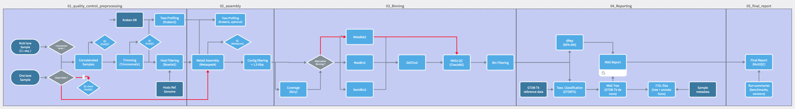

# Metagenomic Pipeline

A [Snakemake](https://snakemake.readthedocs.io/) workflow for shotgun metagenomic sequencing data: raw
paired-end reads in, quality-controlled reads, a metagenome assembly, a set of quality-filtered
metagenome-assembled genomes (MAGs), and a taxonomically classified, dereplicated MAG catalogue out — with
a single aggregated MultiQC report tying it all together.


## Workflow overview



The pipeline runs in four stages, each its own Snakemake module under `workflow/rules/`:

| Stage | What happens | Key tools |
|---|---|---|
| **01 · QC & preprocessing** | Concatenate (or symlink) lanes → FastQC → adapter/quality trimming → FastQC again → host-genome filtering. With `final_report`, Kraken2 also classifies the trimmed reads (how much host/contaminant DNA there was). Optionally (`taxonomic_profiling`), Kraken2 profiles the cleaned reads. | FastQC, Trimmomatic, Bowtie2, Kraken2 |
| **02 · Assembly** | Metagenome assembly, contig QC, and length/coverage filtering of contigs before binning. | metaSPAdes, MetaQuast |
| **03 · Binning** | Alignment-free coverage estimation across all samples (`fairy`), then bin contigs into draft genomes and quality-check them. Two selectable strategies (see below). | fairy, MetaBAT2, MaxBin2, SemiBin2, DAS_Tool, CheckM2 |
| **04 · Reporting** | Taxonomically classify each high-quality bin, dereplicate the catalogue into representative genomes, and produce the final per-MAG summary table. | GTDB-Tk, dRep |

A final, optional stage aggregates every stage's QC metrics (plus per-rule runtime/memory benchmarks) into
one MultiQC report.

### Two binning strategies

The `Alternative Binning?` branch in the diagram is a config switch, not a manual choice made at run time:

- **Consensus binning** (`alternative_binning: false`, default) — runs MetaBAT2, MaxBin2, and SemiBin2 in
  parallel, then merges their bin sets with DAS_Tool to pick the best-scoring consensus bins. SemiBin2 needs
  5+ samples in the binning set (its abundance-input mode's own requirement).
- **Standalone MetaBAT2** (`alternative_binning: true`) — skips MaxBin2/SemiBin2/DAS_Tool entirely and
  quality-filters MetaBAT2's bins directly. Faster, but no cross-tool consensus.

Both feed the same downstream QC filtering step (CheckM2 completeness/contamination thresholds), just into
different output directories (`HighQC_Bins/` vs. `HighQC_Bins_MetaBAT2/` — see [Outputs](#outputs)).

### Two ways to reach "clean data"

The `Clean Data?` branch lets you skip QC/trimming/host-filtering entirely if your reads are already
cleaned (e.g. cleaned upstream, or reused from a previous run): set `steps.QC: false` and point `input_dir`
at a directory containing `{sample}_R{1,2}_cleaned.fastq.gz` files. The pipeline then just runs a
FastQC + MultiQC sanity check on them before proceeding straight to assembly.

## Requirements

- [conda](https://docs.conda.io/) or [mamba](https://mamba.readthedocs.io/) (the tools run in four grouped conda
  environments under `workflow/envs/`: Core, Binning, SemiBin2, Reporting)
- [Snakemake](https://snakemake.readthedocs.io/) 9.x — install into its own environment:
  ```bash
  conda create -c conda-forge -c bioconda -n snakemake snakemake
  conda activate snakemake
  ```
- [`snakemake-executor-plugin-slurm`](https://github.com/snakemake/snakemake-executor-plugin-slurm) — only
  needed for cluster runs, but required for it: as of Snakemake 8+, executors are separate plugins, not
  bundled with Snakemake itself. `profile/slurm/config.yaml` sets `executor: slurm`, so without this plugin
  installed, even a dry run against that profile fails immediately with an "unrecognized executor" error.
  Install it into the same environment as Snakemake:
  ```bash
  conda install -c conda-forge -c bioconda snakemake-executor-plugin-slurm
  # or: pip install snakemake-executor-plugin-slurm
  ```
- Reference databases and files (adapters, host genomes, Kraken2, CheckM2, GTDB-Tk), downloaded or built
  separately — see [Prepare reference data](#3-prepare-reference-data) for which steps need which.
- Access to a SLURM cluster is recommended for real datasets — assembly, binning, and GTDB-Tk classification
  are memory- and time-intensive (see [Resource needs](#resource-needs)). A `profile/slurm/` Snakemake
  profile is included; see [Run it](#6-run-it).

### Resource needs

Defaults in `config/config.yaml`, per job — adjust to your data and cluster:

| Step | Config block | Memory | Time limit | Runs |
|---|---|---|---|---|
| Host indexing (if built) | `host_indexing` | 50 GB | 4 h | once |
| Kraken2 | `kraken2_run` | 200 GB (≥ database size) | 3 h | per sample |
| metaSPAdes assembly | `Metaspade_assembly` | 400 GB | 72 h | per sample |
| MaxBin2 / SemiBin2 | `MaxBin2`, `SemiBin2` | 30–45 GB | 48 h | per sample |
| CheckM2 | `CheckM` | 128 GB | 4 h | per sample |
| GTDB-Tk | `GTDB_Tk` | 160 GB | 24 h | once |

Assembly dominates: memory scales with read depth and community complexity. `02_Results/benchmark_summary.tsv`
records each rule's real peak memory and run time, so use a first run to tune these values.

## Getting started

### 1. Install

```bash
git clone https://github.com/Mabe1399/Mazel_Lab_MetaG_Pipeline.git
cd Mazel_Lab_MetaG_Pipeline
```

Snakemake reads its own dependencies (conda envs listed per rule) lazily on first run via `--use-conda`, so
there's no separate environment-installation step beyond having conda/mamba and Snakemake available.

### 2. Try it on the test data

`test_data/` holds a tiny synthetic 2-sample dataset (already cleaned reads, so `QC: false`) with a
ready-made config whose paths are relative to `workflow/`. It's the quickest way to check an install or a
change — see `test_data/README.md`.

```bash
mkdir -p test_data/_run/{output,scratch,logs,benchmarks}
cd workflow
snakemake -n --configfile ../test_data/config.test.yaml      # dry run
```

For a dry run, `GTDB_Tk.db` in that config must point at any existing folder. A real run also needs your
`CheckM.db` and `GTDB_Tk.db`, and `alternative_binning: true` (SemiBin2 needs 5+ samples). The same dry run
runs on GitHub for every push to `dev`/`main` (`.github/workflows/validate-dag.yml`).

There are no unit tests — the pipeline is validated by these dry runs, in CI and before real runs.

### 3. Prepare reference data

Set these paths in `config/config.yaml` before the first run. Before any job starts, a real run checks that
each one the enabled steps need exists, and stops with a `Pipeline startup failed` list otherwise (a dry
run doesn't run this check). Blank paths that rules use directly are reported even earlier, as
`Pipeline config incomplete`.

| What | Config key | Point it at | Needed when |
|---|---|---|---|
| Adapter sequences | `trimmomatic.trimmomatic_adapters` | One FASTA file | `QC: true` |
| Bowtie2 host index | `host_filtering.index_path` | Index **prefix** (see below) | `QC: true` |
| Host genomes | `host_indexing.Host_refs` | List of FASTA files | `QC: true`, only if the index doesn't exist yet |
| Kraken2 database | `kraken2_db.DB_dir` | Database folder | `taxonomic_profiling: true`, or `QC: true` + `final_report: true` |
| CheckM2 database | `CheckM.db` | The `.dmnd` **file** | Always (bin QC) |
| GTDB-Tk database | `GTDB_Tk.db` | Unpacked release folder | `MAGs_Reporting_step: true` |
| Sample metadata | `DATA_VARIABLES.metadata_path` | TSV or `.xlsx` file | Optional, `iTOL_visualisation: true` |

**Adapters.** Pick the file matching your library prep — `NexteraPE-PE.fa` (Nextera / Illumina DNA Prep) or
`TruSeq3-PE-2.fa` (TruSeq). They ship with Trimmomatic and are in its
[GitHub repo](https://github.com/usadellab/Trimmomatic/tree/main/adapters); keep a copy in a shared folder.

**Bowtie2 host index.** Reads mapping to the host genome(s) are removed. `index_path` is the path *without*
the file extensions: for `/db/bowtie2_index/my_index.1.bt2l`, `my_index.2.bt2l`, … `my_index.rev.2.bt2l`,
write `/db/bowtie2_index/my_index`. The pipeline expects large-index (`.bt2l`) files. If they don't exist,
it builds them from `Host_refs` (plain, uncompressed FASTA; several genomes are concatenated into one index).
Building from several mammal genomes takes hours — raise `host_indexing.runtime_min` if needed. Once built,
other projects can reuse the index and leave `Host_refs: []`.

**Kraken2 database.** Use an existing database, e.g. a prebuilt one from the
[Kraken2 index collection](https://benlangmead.github.io/aws-indexes/k2), unpacked into its own folder
(`hash.k2d`, `opts.k2d`, `taxo.k2d`). Kraken2 loads the whole database into memory, so
`kraken2_run.memory_mb` must exceed its size. The pipeline doesn't build a missing database (the
`build_Kraken2_db` rule and `kraken2_db.refseq` are kept for reference only).

**CheckM2 database.** Download once with `checkm2 database --download --path <dir>`, then set
`CheckM.db: <dir>/CheckM2_database/uniref100.KO.1.dmnd` — the file, not the folder.

**GTDB-Tk database.** GTDB release 232 (`gtdbtk_r232_data.tar.gz`, ~100 GB unpacked) from the
[GTDB data site](https://data.gtdb.ecogenomic.org/), read by the pinned GTDB-Tk 2.8.0; set `GTDB_Tk.db` to
the unpacked folder. Classification needs ~140 GB of RAM (`GTDB_Tk.memory_mb`).

**Sample metadata (iTOL).** Only for the iTOL host-annotation strips; with `metadata_path` blank, the tree is
still built. One row per sample, tab-separated (or `.xlsx`), with at least:

```
Glomus_ID   Host_species
01_PP       Apodemus draco
02_PP       Apodemus ilex
```

- `col_sample_id` / `col_host` name these two columns; sample IDs must match the names the pipeline
  detects (`sample_pattern`).
- `split_criteria` is the text after the sample name in MAG names: `_DASTool_` for consensus binning
  (`01_PP_DASTool_bin_1.fa`), `_bin` for standalone MetaBAT2 (`01_PP_bin.1.fa`).
- `host_colors` maps each `col_host` value to a colour.

### 4. Configure your project

Copy or edit `config/config.yaml` — it holds every path and parameter the pipeline needs:

```yaml
working_dir: /path/to/your/project        # all outputs are written here
scratch_dir: /path/to/fast/scratch        # intermediate files (auto-cleaned)
input_dir:   /path/to/raw/fastqs          # or pre-cleaned fastqs, if steps.QC: false
log_dir:     /path/to/logs
benchmark_dir: /path/to/benchmarks

sample_pattern: '^(Pl\d+_[A-Z]\d+)_.*$'   # regex; group 1 = sample name, applied to every *.fastq.gz / *.fq.gz

steps:
  QC: true                    # false = skip straight to assembly on pre-cleaned reads
  concatenate_lanes: true      # true = cat multi-lane fastqs; false = symlink single-lane fastqs
  taxonomic_profiling: false   # Kraken2 profiling of trimmed reads
  alternative_binning: false   # false = MetaBAT2+MaxBin2+SemiBin2+DAS_Tool; true = standalone MetaBAT2
  MAGs_Reporting_step: true    # GTDB-Tk classification + dRep dereplication + MAG summary table
  iTOL_visualisation: true     # GTDB-Tk tree of all HQ MAGs + iTOL annotation files (with MAGs_Reporting_step)
  final_report: false          # aggregate everything into one MultiQC report
```

Sample names are inferred purely from filenames via `sample_pattern` — there's no separate sample sheet to
maintain. Blank/negative-control samples can be excluded from binning onward (while still passing through QC
and assembly, so you can confirm they show minimal biomass) via `exclude_samples` (explicit names) and/or
`exclude_pattern` (regex).

**Input file names.** Only `sample_pattern` decides what a sample is, but the QC stage then finds each
sample's reads by name, so the lane/read tag must follow the sample name directly:

| `steps.concatenate_lanes` | Expected names | Example for sample `01_PP` |
|---|---|---|
| `true` (several lanes, concatenated) | `{sample}_L*_R1*`, `{sample}_L*_R2*` | `01_PP_L001_R1_001.fastq.gz` |
| `false` (one file per read, symlinked) | `{sample}_R1*`, `{sample}_R2*` | `01_PP_R1.fastq.gz` |

Names with an extra field in between (e.g. Illumina's `01_PP_S12_L001_R1_001.fastq.gz`) are not found.

**Lists in the config** (`exclude_samples`, `kraken2_db.refseq`, `host_indexing.Host_refs`) take one
`- value` per line; quotes are optional, but paths must not contain spaces. For an empty list write `[]`,
not a lone `-` (YAML reads that as one blank entry):

```yaml
exclude_samples:
- E_PP
- E_M
kraken2_db:
  refseq: []
```

**Reference data paths** are described in [Prepare reference data](#3-prepare-reference-data). In the dry run, a
`build_Kraken2_db` or `host_indexing` job means the pipeline didn't find that database at the configured
path — if you already have it, the path is wrong.

Every tool's thread count, memory, and runtime allocation is also set in `config.yaml`, grouped by tool name
(`Trimmomatic:`, `MetaBat2:`, `GTDB_Tk:`, etc.) — adjust these to match your cluster's resources and your
dataset's size.

### 5. Dry run

Always validate the DAG before spending compute on a real run — Snakemake must be invoked from `workflow/`:

```bash
cd workflow
snakemake -n --configfile ../config/config.yaml
```

### 6. Run it

**Locally** (small test datasets):

```bash
snakemake --use-conda --profile ../profile/local --configfile ../config/config.yaml
```

`profile/local/config.yaml` works out of the box (defaults to 4 cores, 4 GB/job) — edit `cores` and
`default-resources` to match your machine. Equivalent to passing `--cores <N>` directly if you'd rather not
use a profile at all. Some rules (host indexing, assembly) work in `$TMPDIR`, which SLURM sets per job; on
a local Linux machine it's often unset, so set it first: `export TMPDIR=/path/to/fast/scratch`.

**On a SLURM cluster:**

```bash
snakemake --use-conda --profile ../profile/slurm
```

Requires `snakemake-executor-plugin-slurm` installed (see [Requirements](#requirements)) — without it,
`executor: slurm` in the profile is unrecognized and even `-n` fails. `profile/slurm/config.yaml` also needs
your SLURM account and conda-environment prefix filled in before first use — it ships with placeholder
values (`slurm_account`, `slurm_extra` mail address, `conda-prefix`).

## Resuming and running part of the pipeline

**Resuming after a failure or interruption:**

```bash
snakemake --rerun-incomplete --use-conda --profile ../profile/slurm
```

**Targeting a specific stage** instead of the full pipeline (useful for inspecting intermediate results, or
re-running just one stage after a config tweak):

```bash
# replace /path/to/your/project with your working_dir
snakemake --use-conda --profile ../profile/slurm \
  /path/to/your/project/02_Results/02_Assembly/Metaquast_QC/multiqc_report.html
```

See the commented reference targets at the top of `workflow/Snakefile`'s `get_final_outputs()` for other
useful stopping points (post-QC, post-taxonomic-profiling, post-MAG-reporting, ...).

To stop after a set of rules instead of a file, use `--until`. For example, **preprocessing only**
(lanes → FastQC → trimming → FastQC → host filtering, ending with the cleaned reads in
`00_Data/02_Clean_Data/`):

```bash
snakemake --use-conda --profile ../profile/slurm \
  --until host_filtering before_multiqc After_multiqc
```

With `final_report: true`, add `run_kraken2` to the list to also run the per-sample Kraken2 classification
(it otherwise runs later, for the final report). Run the same command without `--until` to continue from
there.

## Outputs

Everything is written under `working_dir`, split into two top-level trees:

- **`01_Analysis/`** — per-tool intermediate outputs. Most of this is aggressively cleaned up automatically
  once no longer needed (Snakemake `temp()`), to keep disk usage bounded on shared cluster storage.
- **`02_Results/`** — the outputs you actually want to keep:
  - `01_QC_Preprocessing/` — FastQC/MultiQC before-and-after reports; combined Kraken2 report of the
    trimmed reads (with `final_report`)
  - `02b_Taxonomic_Profiling/` — combined Kraken2 profile of the cleaned reads (with `taxonomic_profiling`)
  - `02_Assembly/` — filtered contigs per sample, MetaQuast assembly-QC report
  - `03_Binning/` — `all_MAGs_stats.tsv` / `filtered_MAGs_stats.tsv` (CheckM2 completeness/contamination for
    every bin) and the final quality-filtered bin FASTAs (`HighQC_Bins/` or `HighQC_Bins_MetaBAT2/`,
    depending on which binning strategy is enabled)
  - `04_MAGs_Reporting_Annotating/` — `MAG_Representative_info_parsed.tsv` (the final per-MAG summary:
    completeness, contamination, taxonomy, dereplication cluster), plus an iTOL-ready tree and annotation
    files (with `iTOL_visualisation`)
  - `MultiQC_FinalReport/` — the pipeline-wide report, if `final_report: true`
  - `benchmark_summary.tsv` — wall time / peak memory / CPU time per rule, for spotting bottlenecks
  - `tool_versions.tsv` — exact installed version of every external tool used in the run (always generated,
    independent of `final_report`), queried from each tool's own conda env at run time

## Troubleshooting

Errors raised before any job is submitted are almost always a config problem. Common ones:

| Message | Cause | Fix |
|---|---|---|
| `Pipeline config incomplete — these paths are blank` | A path an enabled step needs is empty | Fill it in — see [Prepare reference data](#3-prepare-reference-data) |
| `Pipeline startup failed:` followed by `[config] ... not found` lines | Those paths don't exist (real runs only; checked before any job starts) | Fix each listed path |
| `build_Kraken2_db` or `host_indexing` in the dry run when you have the database | `kraken2_db.DB_dir` / `host_filtering.index_path` doesn't point at it | Fix the path (`index_path` is a prefix, not a folder) |
| `TypeError: sequence item 0: expected str instance, NoneType found` (in `build_Kraken2_db` or `host_indexing`) | v2.0 only: a lone `-` under `kraken2_db.refseq` or `host_indexing.Host_refs` | Update the pipeline, or write `refseq: []` / `Host_refs: []` |
| `config['exclude_samples'] contains invalid entries: [None]` | A lone `-` under `exclude_samples` | `exclude_samples: []` |
| `AmbiguousRuleException` for `run_kraken2` / `kraken2_Taxonomic_Profiling`, or `Missing input files for rule all` (`Combined_kraken2_report.tsv`) | v2.0 only: `taxonomic_profiling: true` was broken | Update the pipeline |
| `no R1 file found for sample ...` | Input file names don't match `concatenate_lanes` | See *Input file names* under [Configure your project](#4-configure-your-project) |
| `SemiBin2_binning` fails | Fewer than 5 non-excluded samples | Set `alternative_binning: true` |

For an error inside a job, read that job's log under `log_dir` (the path is printed in the error); every
rule writes its tool output there.

## Repository layout

```
config/
  config.yaml            # project paths, steps on/off, per-tool resources
  multiqc_config.yaml     # final-report layout (module order, custom benchmark section)
profile/
  slurm/config.yaml       # SLURM executor defaults (jobs, partition, memory, use-conda)
  local/config.yaml       # single-machine defaults (cores, per-job memory, use-conda)
workflow/
  Snakefile               # entry point: config-driven inclusion of the rule modules below
  rules/                  # one file per pipeline stage (01 through 05)
  scripts/                # Python helpers invoked by rules (parsing, aggregation)
  envs/                   # 4 grouped conda environments (Core, Binning, SemiBin2, Reporting)
```
