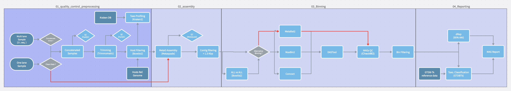

# Metagenomic Pipeline

A [Snakemake](https://snakemake.readthedocs.io/) workflow for shotgun metagenomic sequencing data: raw
paired-end reads in, quality-controlled reads, a metagenome assembly, a set of quality-filtered
metagenome-assembled genomes (MAGs), and a taxonomically classified, dereplicated MAG catalogue out — with
a single aggregated MultiQC report tying it all together.


## Workflow overview



The pipeline runs in four stages, each its own Snakemake module under `workflow/rules/`:

| Stage | What happens | Key tools |
|---|---|---|
| **01 · QC & preprocessing** | Concatenate (or symlink) lanes → FastQC → adapter/quality trimming → host-genome filtering → FastQC again. Optionally also runs Kraken2 taxonomic profiling on the trimmed reads. | FastQC, Trimmomatic, Bowtie2, Kraken2 |
| **02 · Assembly** | Metagenome assembly, contig QC, and length/coverage filtering of contigs before binning. | metaSPAdes, MetaQuast |
| **03 · Binning** | Alignment-free coverage estimation across all samples (`fairy`), then bin contigs into draft genomes and quality-check them. Two selectable strategies (see below). | fairy, MetaBAT2, MaxBin2, SemiBin2, DAS_Tool, CheckM2 |
| **04 · Reporting** | Taxonomically classify each high-quality bin, dereplicate the catalogue into representative genomes, and produce the final per-MAG summary table. | GTDB-Tk, dRep |

A final, optional stage aggregates every stage's QC metrics (plus per-rule runtime/memory benchmarks) into
one MultiQC report.

### Two binning strategies

The `Alternative Binning?` branch in the diagram is a config switch, not a manual choice made at run time:

- **Consensus binning** (`alternative_binning: false`, default) — runs MetaBAT2, MaxBin2, and SemiBin2 in
  parallel, then merges their bin sets with DAS_Tool to pick the best-scoring consensus bins. SemiBin2 needs
  5+ samples in the binning set (its abundance-input mode's own requirement).
- **Standalone MetaBAT2** (`alternative_binning: true`) — skips MaxBin2/SemiBin2/DAS_Tool entirely and
  quality-filters MetaBAT2's bins directly. Faster, but no cross-tool consensus.

Both feed the same downstream QC filtering step (CheckM2 completeness/contamination thresholds), just into
different output directories (`HighQC_Bins/` vs. `HighQC_Bins_MetaBAT2/` — see [Outputs](#outputs)).

### Two ways to reach "clean data"

The `Clean Data?` branch lets you skip QC/trimming/host-filtering entirely if your reads are already
cleaned (e.g. cleaned upstream, or reused from a previous run): set `steps.QC: false` and point `input_dir`
at a directory containing `{sample}_R{1,2}_cleaned.fastq.gz` files. The pipeline then just runs a
FastQC + MultiQC sanity check on them before proceeding straight to assembly.

## Requirements

- [conda](https://docs.conda.io/) or [mamba](https://mamba.readthedocs.io/) (each pipeline stage runs in its
  own tool-specific conda environment, defined under `workflow/envs/`)
- [Snakemake](https://snakemake.readthedocs.io/) 9.x — install into its own environment:
  ```bash
  conda create -c conda-forge -c bioconda -n snakemake snakemake
  conda activate snakemake
  ```
- [`snakemake-executor-plugin-slurm`](https://github.com/snakemake/snakemake-executor-plugin-slurm) — only
  needed for cluster runs, but required for it: as of Snakemake 8+, executors are separate plugins, not
  bundled with Snakemake itself. `profile/slurm/config.yaml` sets `executor: slurm`, so without this plugin
  installed, even a dry run against that profile fails immediately with an "unrecognized executor" error.
  Install it into the same environment as Snakemake:
  ```bash
  conda install -c conda-forge -c bioconda snakemake-executor-plugin-slurm
  # or: pip install snakemake-executor-plugin-slurm
  ```
- Reference databases you plan to use, downloaded/built separately:
  - A [Kraken2](https://github.com/DerrickWood/kraken2) database (host filtering + optional taxonomic
    profiling)
  - Host reference genome(s) in FASTA format, for building the Bowtie2 host-filtering index
  - A [CheckM2](https://github.com/chklovski/CheckM2) DIAMOND reference database (`checkm2 database --download`)
  - A [GTDB-Tk](https://github.com/Ecogenomics/GTDBTk) reference database (MAG taxonomic classification)
- Access to a SLURM cluster is recommended for real datasets — assembly, binning, and GTDB-Tk classification
  are memory- and time-intensive. A `profile/slurm/` Snakemake profile is included; see
  [Running on SLURM](#running-on-slurm).

## Getting started

```bash
git clone https://github.com/Mabe1399/Mazel_Lab_MetaG_Pipeline.git
cd Mazel_Lab_MetaG_Pipeline
```

Snakemake reads its own dependencies (conda envs listed per rule) lazily on first run via `--use-conda`, so
there's no separate environment-installation step beyond having conda/mamba and Snakemake available.

### 1. Configure your project

Copy or edit `config/config.yaml` — it holds every path and parameter the pipeline needs:

```yaml
working_dir: /path/to/your/project        # all outputs are written here
scratch_dir: /path/to/fast/scratch        # intermediate files (auto-cleaned)
input_dir:   /path/to/raw/fastqs          # or pre-cleaned fastqs, if steps.QC: false
log_dir:     /path/to/logs
benchmark_dir: /path/to/benchmarks

sample_pattern: '^(Pl\d+_[A-Z]\d+)_.*$'   # regex; group 1 = sample name, applied to every *.fastq.gz / *.fq.gz

steps:
  QC: true                    # false = skip straight to assembly on pre-cleaned reads
  concatenate_lanes: true      # true = cat multi-lane fastqs; false = symlink single-lane fastqs
  taxonomic_profiling: false   # Kraken2 profiling of trimmed reads
  alternative_binning: false   # false = MetaBAT2+MaxBin2+SemiBin2+DAS_Tool; true = standalone MetaBAT2
  MAGs_Reporting_step: true    # GTDB-Tk classification + dRep dereplication + MAG summary table
  iTOL_visualisation: true     # GTDB-Tk tree of all HQ MAGs + iTOL annotation files (with MAGs_Reporting_step)
  final_report: false          # aggregate everything into one MultiQC report
```

Sample names are inferred purely from filenames via `sample_pattern` — there's no separate sample sheet to
maintain. Blank/negative-control samples can be excluded from binning onward (while still passing through QC
and assembly, so you can confirm they show minimal biomass) via `exclude_samples` (explicit names) and/or
`exclude_pattern` (regex).

Every tool's thread count, memory, and runtime allocation is also set in `config.yaml`, grouped by tool name
(`Trimmomatic:`, `MetaBat2:`, `GTDB_Tk:`, etc.) — adjust these to match your cluster's resources and your
dataset's size.

### 2. Dry run

Always validate the DAG before spending compute on a real run — Snakemake must be invoked from `workflow/`:

```bash
cd workflow
snakemake -n --configfile ../config/config.yaml
```

### 3. Run it

**Locally** (small test datasets):

```bash
snakemake --use-conda --profile ../profile/local --configfile ../config/config.yaml
```

`profile/local/config.yaml` works out of the box (defaults to 4 cores, 4 GB/job) — edit `cores` and
`default-resources` to match your machine. Equivalent to passing `--cores <N>` directly if you'd rather not
use a profile at all.

**On a SLURM cluster:**

```bash
snakemake --use-conda --profile ../profile/slurm
```

Requires `snakemake-executor-plugin-slurm` installed (see [Requirements](#requirements)) — without it,
`executor: slurm` in the profile is unrecognized and even `-n` fails. `profile/slurm/config.yaml` also needs
your SLURM account and conda-environment prefix filled in before first use — it ships with placeholder
values (`slurm_account`, `slurm_extra` mail address, `conda-prefix`).

**Resuming after a failure or interruption:**

```bash
snakemake --rerun-incomplete --use-conda --profile ../profile/slurm
```

**Targeting a specific stage** instead of the full pipeline (useful for inspecting intermediate results, or
re-running just one stage after a config tweak):

```bash
snakemake --use-conda --profile ../profile/slurm \
  "$OUTPUT_DIR/02_Results/02_Assembly/Metaquast_QC/multiqc_report.html"
```

See the commented reference targets at the top of `workflow/Snakefile`'s `get_final_outputs()` for other
useful stopping points (post-QC, post-taxonomic-profiling, post-MAG-reporting, ...).

## Outputs

Everything is written under `working_dir`, split into two top-level trees:

- **`01_Analysis/`** — per-tool intermediate outputs. Most of this is aggressively cleaned up automatically
  once no longer needed (Snakemake `temp()`), to keep disk usage bounded on shared cluster storage.
- **`02_Results/`** — the outputs you actually want to keep:
  - `01_QC_Preprocessing/` — FastQC/MultiQC before-and-after reports, combined Kraken2 report
  - `02_Assembly/` — filtered contigs per sample, MetaQuast assembly-QC report
  - `03_Binning/` — `all_MAGs_stats.tsv` / `filtered_MAGs_stats.tsv` (CheckM2 completeness/contamination for
    every bin) and the final quality-filtered bin FASTAs (`HighQC_Bins/` or `HighQC_Bins_MetaBAT2/`,
    depending on which binning strategy is enabled)
  - `04_MAGs_Reporting_Annotating/` — `MAG_Representative_info_parsed.tsv` (the final per-MAG summary:
    completeness, contamination, taxonomy, dereplication cluster), plus an iTOL-ready annotated tree
  - `MultiQC_FinalReport/` — the pipeline-wide report, if `final_report: true`
  - `benchmark_summary.tsv` — wall time / peak memory / CPU time per rule, for spotting bottlenecks
  - `tool_versions.tsv` — exact installed version of every external tool used in the run (always generated,
    independent of `final_report`), queried from each tool's own conda env at run time

## Repository layout

```
config/
  config.yaml            # project paths, steps on/off, per-tool resources
  multiqc_config.yaml     # final-report layout (module order, custom benchmark section)
profile/
  slurm/config.yaml       # SLURM executor defaults (jobs, partition, memory, use-conda)
  local/config.yaml       # single-machine defaults (cores, per-job memory, use-conda)
workflow/
  Snakefile               # entry point: config-driven inclusion of the rule modules below
  rules/                  # one file per pipeline stage (01 through 05)
  scripts/                # Python helpers invoked by rules (parsing, aggregation)
  envs/                   # one conda environment per tool family
```

## Notes

- There's no test suite — this is a compute pipeline validated by dry runs (`snakemake -n`) against real
  sequencing data, not unit-testable in isolation.
